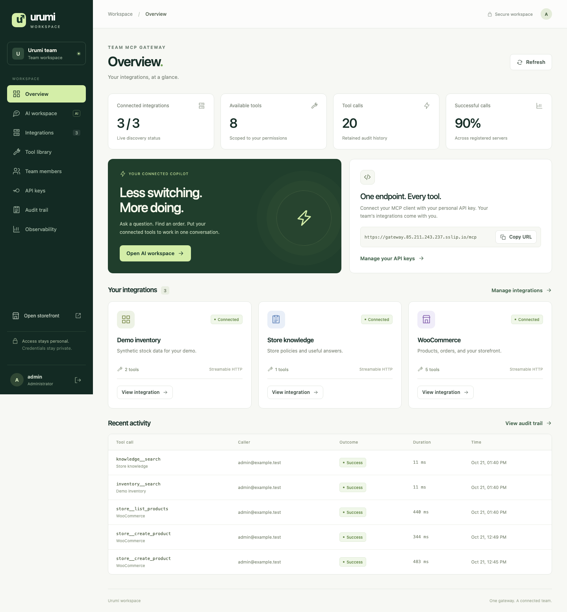
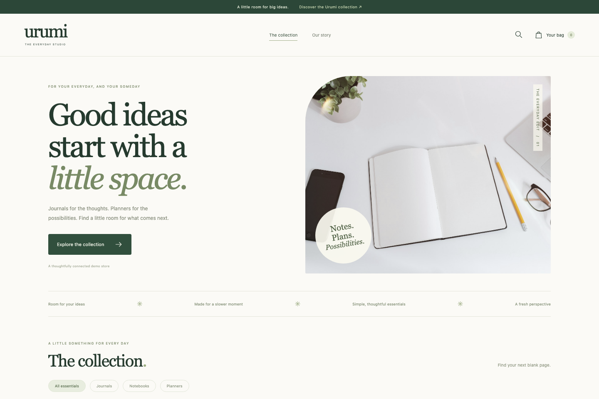

# Urumi team MCP gateway

A WooCommerce hosting platform on Kubernetes with a React dashboard, shared MCP gateway, team chat and multi-store provisioning. The same Helm chart runs on local k3d and the hosted Azure k3s deployment.

## Review the live application

No installation or provider API key is needed to use the hosted demo.

| Application | Account | Credentials file |
| --- | --- | --- |
| [Dashboard](https://gateway.85.211.243.237.sslip.io/) | Dashboard admin | [Open admin credentials](docs/reviewer-credentials/dashboard-admin.json) |
| [Dashboard](https://gateway.85.211.243.237.sslip.io/) | Dashboard member | [Open member credentials](docs/reviewer-credentials/dashboard-member.json) |
| [WooCommerce administration](https://store.85.211.243.237.sslip.io/wp-admin/) | WooCommerce shop manager | [Open WooCommerce credentials](docs/reviewer-credentials/woocommerce.json) |
| [Storefront](https://store.85.211.243.237.sslip.io/shop/) | Guest customer | No login required |

Open the application, then copy its login from the corresponding credentials file. These dedicated demo accounts are intentionally public; provider and infrastructure credentials remain private.

MCP endpoint: `https://gateway.85.211.243.237.sslip.io/mcp`. Sign in as the reviewer member and generate your own personal API key under **API keys**.

### Suggested review flow

1. Sign into the dashboard as the reviewer admin. Inspect **Integrations**, **Tool library**, **Audit trail** and **Observability**.
2. In **AI workspace**, request a uniquely named product and price, tick **Approve changes for this message**, and send once. Inspect the confirmed tool result.
3. Open the storefront in a private browser window, purchase that exact product using fictional details and **Cash on delivery**, then find its order number in WooCommerce admin. Ask chat for today's orders in the original store and match the result.
4. In a separate browser profile, sign in as the reviewer member. Generate a personal key under **API keys**. Connect a Streamable HTTP MCP client using the endpoint above and `Authorization: Bearer YOUR_KEY`. Verify permitted tools, retrieve the same order and revoke your test key to check rejection. The live API key is generated in the dashboard; no upstream credential is required.
5. Open **Stores** to create disposable stores. After they reach Ready, place today's test orders in two stores and ask chat to compare them. Delete one of your disposable stores, check its tools disappear, and confirm the other remains available.

See the [reviewer walkthrough](docs/reviewer-guide.md) for full two-user, permissions, audit, multi-store and failure-isolation checks. The demo shares state, so products and counts may differ from the recording. Groq quotas still apply to hosted chat. Provider and infrastructure credentials remain private.

## What the app does

- Runs a WooCommerce storefront with cart, guest checkout and cash-on-delivery test orders.
- Exposes products and orders through a custom WooCommerce MCP server using Streamable HTTP and the WooCommerce REST API.
- Aggregates WooCommerce, demo inventory and knowledge tools, with namespaced routing, per-role permissions and upstream timeouts.
- Provides a chat agent that calls the gateway as the signed-in user, with explicit approval for writes and visible tool activity.
- Manages team invitations, personal API keys, revocation, attributed audit logs and per-server metrics.
- Optionally provisions independent stores from the dashboard, with automatic MCP registration, namespace isolation, quotas, retry and clean deletion.

## Screenshots

Captured from the running assessment deployment; available stores, counts and products change during review.

### Team workspace

### WooCommerce storefront

## Verification and implementation evidence

The [requirements checklist](docs/requirements.md) maps demonstrated behavior to implementation evidence. [Multi-store design and verification](docs/multi-store.md) covers namespace isolation, quotas, automatic registration, retry/restart recovery and teardown. The video demonstrates the two-user flow and controlled upstream outage on the live deployment.

To run the application and automated checks independently, follow [local installation and verification](docs/local-setup.md). Local setup generates its own credentials; the reviewer logins above apply to the hosted demo only.

## Known limitations

- Single-node local-path storage survives pod replacement, not node/disk loss. There is no high availability. The primary-store backup helper refuses managed-store installations; coordinated multi-store disaster recovery is not implemented.
- LLM provider quotas still apply. Inspect completed tool activity before retrying an interrupted turn. Successful writes return a receipt from the tool result without another model request; failed writes are not automatically replayed.
- Inventory is synthetic demo data, not synchronized WooCommerce stock. Test products are virtual, COD collects no real payment, and outbound email is not configured.
- Managed-store lifecycle ownership is separate from shared team tool access. Role-permitted team members can read enabled stores; this is not isolation between unrelated customer organizations.
- Gateway OAuth, arbitrary container-image MCP hosting, public IPv6 upstreams and multi-replica scaling are not implemented. Untrusted upstream tool content remains a prompt-injection risk.

## Technical documentation

- [Gateway architecture and tradeoffs](docs/gateway-design.md)
- [Access controls and threat model](docs/access-and-threat-model.md)
- [Custom WooCommerce MCP server](docs/woocommerce-mcp.md) and [store architecture](docs/store-architecture.md)
- [Multi-store provisioning, isolation and recovery](docs/multi-store.md)
- [Azure deployment, configuration, cost and cleanup](docs/production-deployment.md)
- [Upgrades, rollback and primary-store backup/restore](docs/upgrades-and-recovery.md)
- [Chat, diagnostics and security checks](docs/chat-and-operations.md)
- [Implemented differentiators](docs/standouts.md) and [storefront design/photo credits](docs/storefront-design.md)
